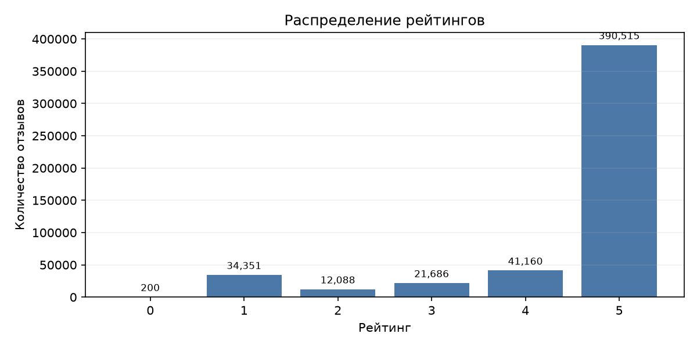
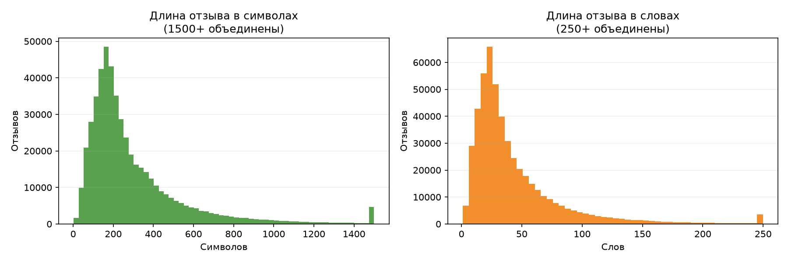
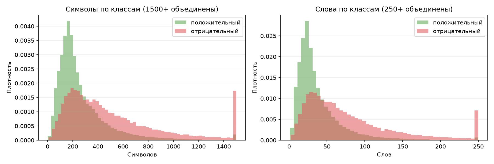
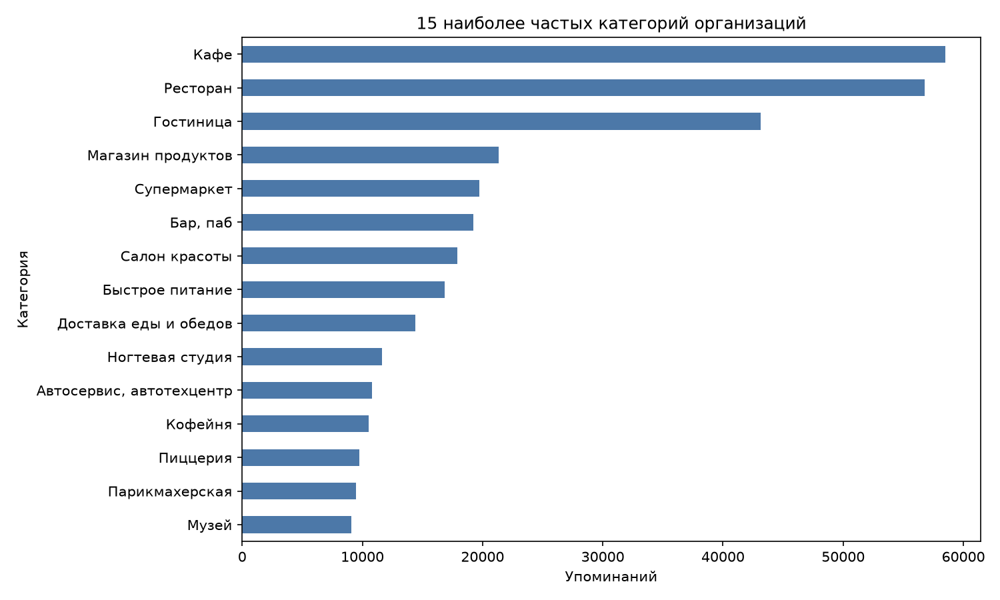
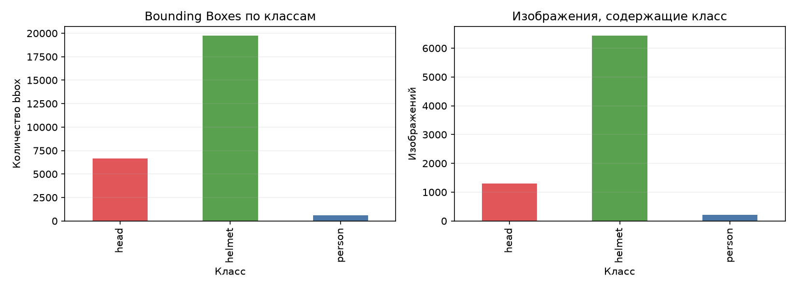
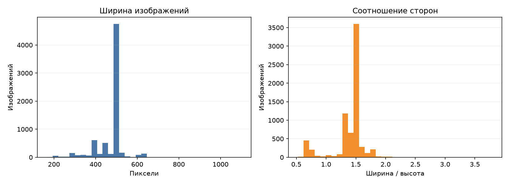
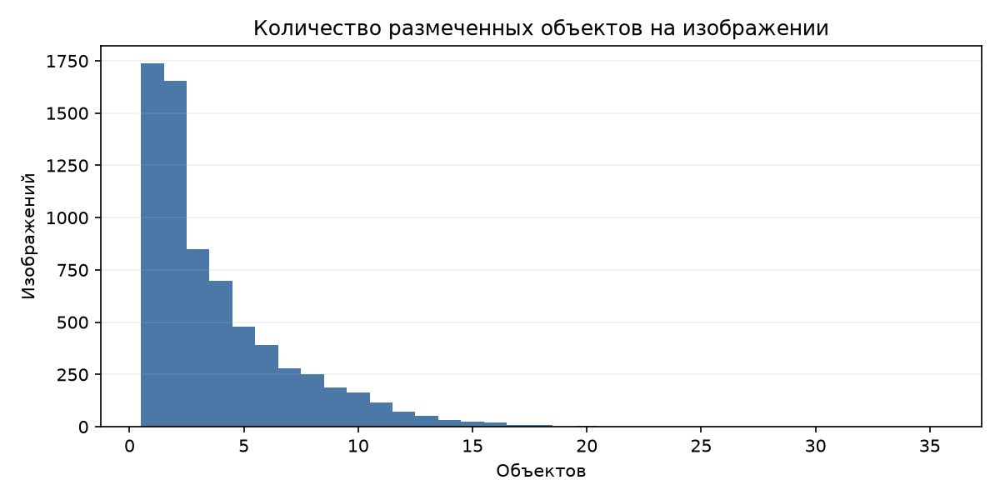
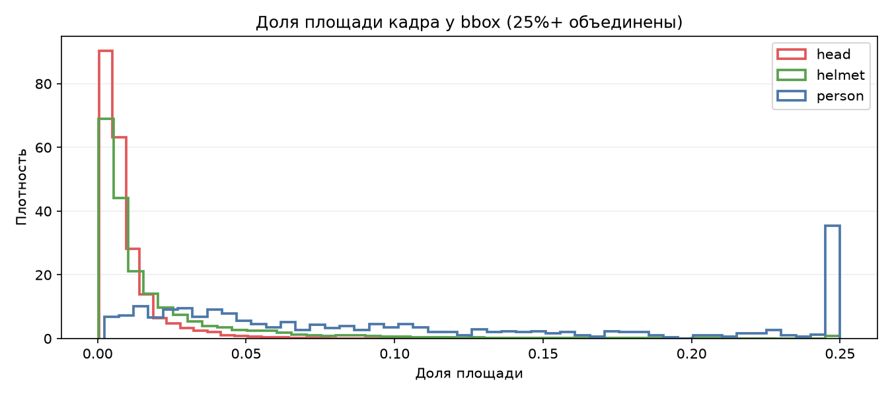

# Результаты первичного исследовательского анализа данных

## Цель

EDA выполнен до формирования рабочих выборок и обучения моделей. Анализ проверяет структуру, качество, распределение классов, потенциальные утечки и ограничения двух исходных датасетов. Все статистики рассчитаны на полных локальных наборах без изменения `data/raw/`.

## Методика

Geo Reviews прочитан из единственного Parquet-файла средствами pandas/PyArrow. Проверены типы, память, пропуски, пустые строки, полные и текстовые дубликаты, рейтинги, длина текста, категории и примеры потенциального конфликта текста с рейтингом.

Для Hard Hat Workers сопоставлены все изображения и TXT-файлы. Каждая строка YOLO проверена на число полей, числовой формат, класс, диапазон координат, положительные размеры и выход за границы. Все изображения открыты Pillow, рассчитаны размеры и SHA-256. Выборочный визуальный аудит проводился локально; фотографии с людьми не включены в публичный отчёт.

## Geo Reviews Dataset 2023

### Структура и качество

| Показатель | Значение |
| --- | ---: |
| Строк | 500 000 |
| Исходных столбцов | 5 |
| Размер Parquet | 170 880 716 байт |
| Память DataFrame (`deep=True`) | 377 278 176 байт / 359,80 МиБ |
| Пропуски `name_ru` | 970 / 0,194% |
| Пропуски в остальных столбцах | 0 |
| Пустые/пробельные тексты | 0 |
| Лишние полные дубликаты | 1 |
| Строки в группах одинакового текста | 190 |
| Лишние копии текста | 115 |
| Повторяющиеся уникальные тексты | 75 |
| Строки с Unicode replacement character | 1 |

Поля: `address`, `name_ru`, `rating`, `rubrics`, `text`. `rubrics` хранит категории строкой с разделителем `;`; после разделения найдено 1 370 отдельных категорий.

### Распределение рейтингов

| Рейтинг | Отзывов | Доля |
| --- | ---: | ---: |
| 0 | 200 | 0,0400% |
| 1 | 34 351 | 6,8702% |
| 2 | 12 088 | 2,4176% |
| 3 | 21 686 | 4,3372% |
| 4 | 41 160 | 8,2320% |
| 5 | 390 515 | 78,1030% |

При предварительном правиле `1–2 → negative`, `4–5 → positive` остаётся 478 114 отзывов: 431 675 положительных (90,287%) и 46 439 отрицательных (9,713%). 21 886 строк с рейтингами 0 и 3 исключались бы. Соотношение классов — 9,30:1; случайная рабочая подвыборка без стратификации непригодна.

### Длина текстов

| Показатель | Символы | Слова/непробельные токены |
| --- | ---: | ---: |
| Минимум | 2 | 1 |
| 25-й перцентиль | 145 | 20 |
| Медиана | 215 | 30 |
| Среднее | 303,23 | 43,74 |
| 75-й перцентиль | 365 | 52 |
| 95-й перцентиль | 809 | 120 |
| 99-й перцентиль | 1 445 | 219 |
| Максимум | 20 162 | 2 918 |

Отрицательные отзывы длиннее: среднее 531,07 и медиана 399 символов против 272,44 и 203 у положительных. Длина может стать shortcut-признаком и должна контролироваться в split и анализе устойчивости.

### Категории и качество слабых меток

Наиболее часты `Кафе` (58 496 упоминаний), `Ресторан` (56 761) и `Гостиница` (43 133). Категории различаются по доле положительных рейтингов, поэтому категория или название организации могут создавать нежелательный shortcut. Для заявленной постановки основным входом должен быть текст.

Выборочный аудит обнаружил как положительно сформулированные тексты с рейтингом 1–2, так и отрицательные с рейтингом 4–5. Примеры не публикуются в отчёте, но проверка воспроизводима в ноутбуке на локальном датасете. Рейтинг является слабой, а не гарантированно правильной меткой. Значение `rating=0` встречается у 200 содержательных отзывов и не должно автоматически трактоваться как negative.

### Рекомендации

- Рассмотреть сбалансированную рабочую выборку 2 400 текстов, по 1 200 на класс.
- Сохранить рейтинги 0 и 3 отдельно до методологического решения.
- Группировать одинаковые нормализованные тексты до train/validation/test.
- Стратифицировать по длине и категориям, сохраняя сложные случаи.
- Не использовать рейтинг, адрес или название организации как признаки тональности текста.
- Провести двойную ручную разметку контрольной части без показа рейтинга.

## Hard Hat Workers v10

### Структура и техническая корректность

| Часть | Изображения | TXT | `head` bbox | `helmet` bbox | `person` bbox | Все bbox |
| --- | ---: | ---: | ---: | ---: | ---: | ---: |
| train | 4 916 | 4 916 | 4 612 | 13 919 | 450 | 18 981 |
| valid | 1 413 | 1 413 | 1 339 | 3 913 | 101 | 5 353 |
| test | 706 | 706 | 726 | 1 915 | 64 | 2 705 |
| **Итого** | **7 035** | **7 035** | **6 677** | **19 747** | **615** | **27 039** |

Пустых аннотаций, отсутствующих пар image/TXT, строк неправильного формата, неизвестных классов, неположительных размеров и выходов рамок за границы не обнаружено. Все изображения — читаемые RGB JPEG. Техническая корректность формата не доказывает полноту разметки.

`person` составляет только 2,27% рамок и встречается на 209 изображениях (2,97%). Выборочный локальный аудит подтвердил хотя бы один кадр с видимым человеком без `person`-рамки; массовая доля пропусков не оценивалась.

### Изображения и число объектов

| Показатель | Ширина, px | Высота, px | Aspect ratio |
| --- | ---: | ---: | ---: |
| Минимум | 167 | 126 | 0,530 |
| Среднее | 477,06 | 358,58 | 1,394 |
| Медиана | 500 | 333 | 1,500 |
| Максимум | 1 100 | 965 | 3,793 |

На одном изображении от 1 до 35 объектов, в среднем 3,8435 и медианно 3. Изображений без объектов нет.

### Размеры Bounding Boxes

| Класс | Медиана ширины | Медиана высоты | Медиана площади кадра |
| --- | ---: | ---: | ---: |
| `head` | 0,0580 | 0,1042 | 0,00603 |
| `helmet` | 0,0710 | 0,1182 | 0,00829 |
| `person` | 0,1560 | 0,4926 | 0,07826 |

15 798 рамок (58,427%) занимают менее 1% кадра; 262 (0,969%) — менее 0,1%. Особенно малы `head`: 4 782 из 6 677 рамок этого класса занимают менее 1% изображения. В будущих экспериментах требуется контролировать входное разрешение и метрики по масштабу объектов.

### Дубликаты и визуальный аудит

SHA-256 не обнаружил точных дубликатов ни внутри полного набора, ни между train/valid/test. Метод не выявляет перекодированные, обрезанные и почти одинаковые кадры.

Локально просмотрены шесть размеченных сцен: одиночный объект, плотные группы, головы без касок, `person` и сочетания классов. Рамки на этих примерах геометрически совпадают с объектами; обнаружена неполнота `person` и вариативная плотность `helmet`-рамок. Иллюстрация не публикуется до проверки прав на фотографии и допустимости распространения изображений людей.

### Рекомендации по подготовке данных

- Согласовать двухклассовую схему `head`/`helmet` как основной кандидат; исходный `person` не удалять.
- Если сохраняются три класса, расширить визуальный аудит и доразметить `person` по codebook.
- Для финального обучения предпочтительно использовать все 7 035 изображений; подвыборка 2 000–3 000 подходит только для прототипа.
- При синтетических преобразованиях изменять Bounding Boxes вместе с изображением и использовать только исходные train-объекты.
- До финальной оценки дополнить SHA-256 перцептивным поиском кандидатов с ручным подтверждением.

## Ограничения EDA

- Семантика `rating=0` не установлена по самим данным.
- Эвристический поиск конфликтов текста и рейтинга не измеряет точную долю ошибочных меток.
- Выборочный визуальный аудит не доказывает качество всех 7 035 изображений.
- Почти одинаковые изображения не проверялись.
- Лицензия Hard Hat Workers подтверждена только на уровне метаданных поставщика.
- Экспортированные пути в исходном `data.yaml` не соответствуют локальной структуре; EDA не зависит от этих путей.

## Вывод

Geo Reviews пригоден для бинарной тональности после балансировки, группировки повторов и ручного контроля слабых меток. Hard Hat Workers технически корректен по формату, но трёхклассовая постановка ограничена редкостью и неполнотой `person`; основным кандидатом остаётся схема `head`/`helmet`.
