# Разведочный анализ данных

## Geo Reviews Dataset 2023

Исходный набор содержит 500 000 отзывов и пять полей: адрес, название организации, рейтинг, рубрики и текст.

| Показатель | Значение |
| --- | ---: |
| Строки | 500 000 |
| Пропуски `name_ru` | 970 |
| Пустые тексты | 0 |
| Лишние полные дубликаты | 1 |
| Строки с повторяющимся текстом | 190 |
| Лишние копии текста | 115 |

### Рейтинги и тексты

| Рейтинг | Отзывы | Доля |
| --- | ---: | ---: |
| 0 | 200 | 0,04% |
| 1 | 34 351 | 6,87% |
| 2 | 12 088 | 2,42% |
| 3 | 21 686 | 4,34% |
| 4 | 41 160 | 8,23% |
| 5 | 390 515 | 78,10% |

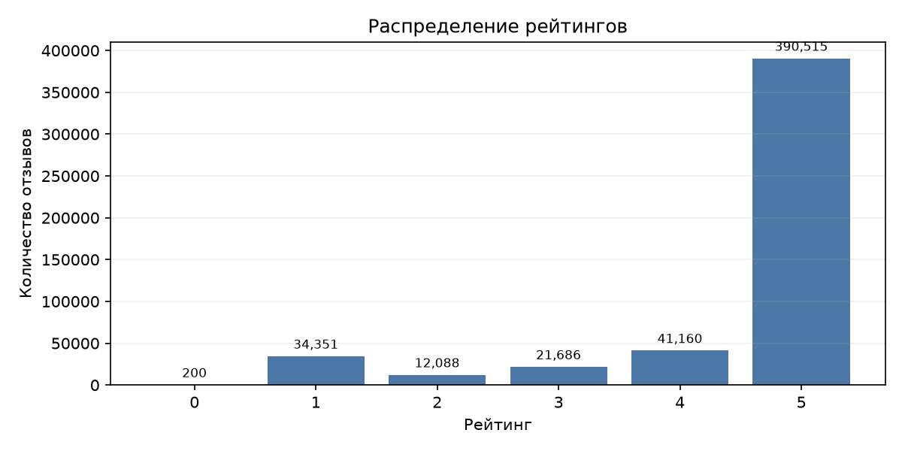

При правиле `1–2 → negative`, `4–5 → positive` исходное соотношение классов составляет 9,30:1. Поэтому рабочая выборка формируется контролируемо и балансируется.

Медианная длина текста равна 215 символам, средняя — 303,23, 95-й перцентиль — 809. Отрицательные отзывы в среднем длиннее положительных, поэтому длина может стать нежелательным косвенным признаком.

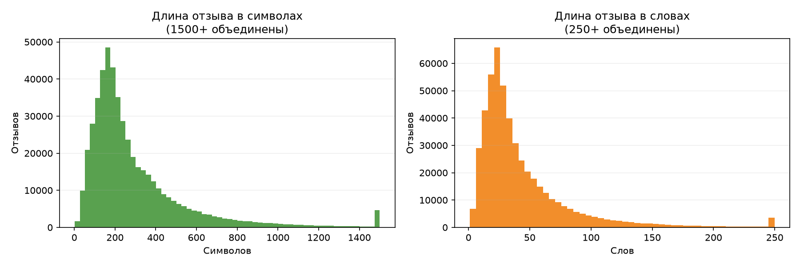

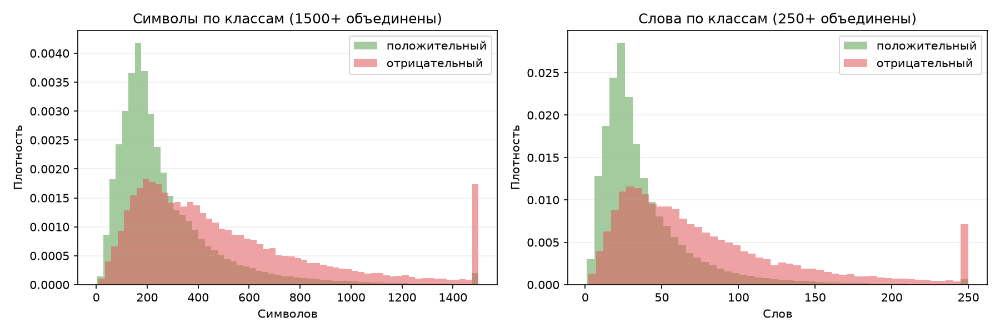

Полный набор охватывает разные типы организаций. Для курсовой используются только записи с точной рубрикой `Быстрое питание` и проверенным названием сети.

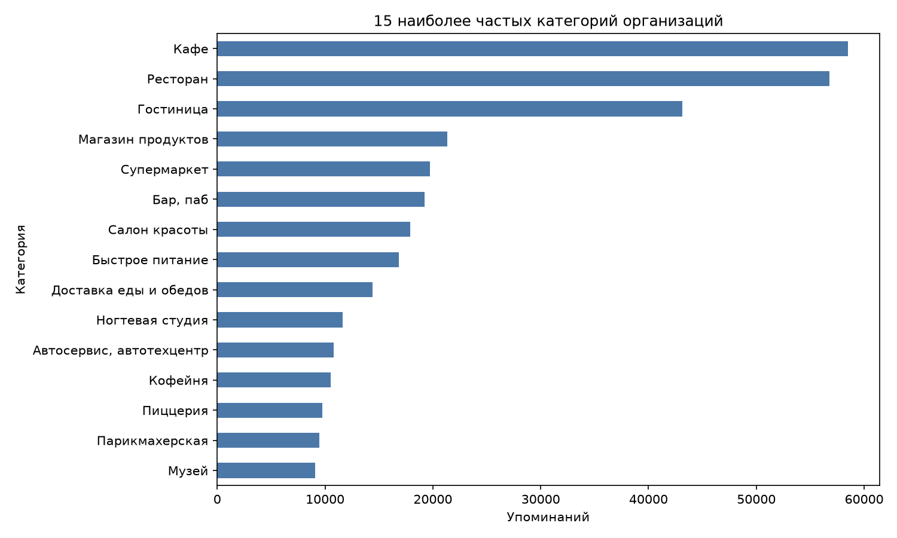

### Актуальная выборка из 1 000 отзывов

После предметного отбора доступный пул содержит 2 532 пригодных бинарных отзыва.

| Сеть | Отрицательных | Положительных | Пригодных |
| --- | ---: | ---: | ---: |
| KFC | 241 | 490 | 731 |
| Burger King | 127 | 368 | 495 |
| Вкусно — и точка | 362 | 894 | 1 256 |
| Rostic's | 14 | 36 | 50 |

Итоговая выборка сбалансирована по классу внутри каждого бренда.

| Сеть | Класс 0 | Класс 1 | Всего |
| --- | ---: | ---: | ---: |
| KFC | 180 | 180 | 360 |
| Burger King | 127 | 127 | 254 |
| Вкусно — и точка | 179 | 179 | 358 |
| Rostic's | 14 | 14 | 28 |
| **Итого** | **500** | **500** | **1 000** |

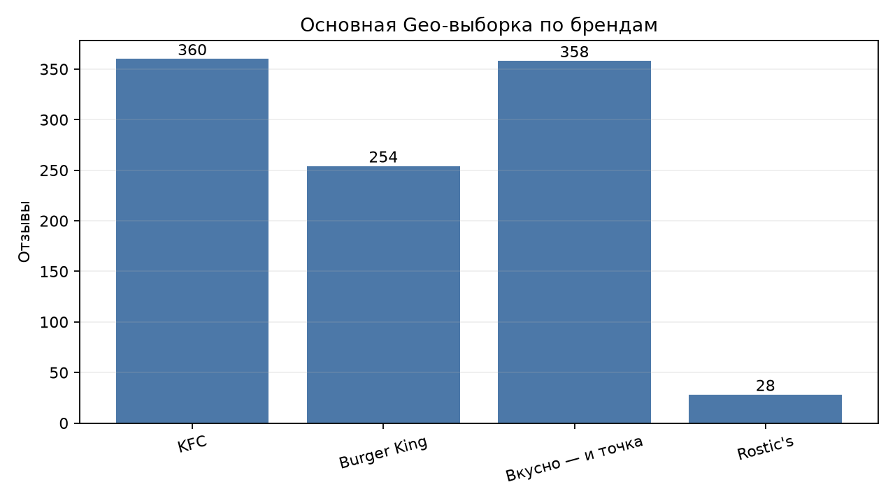

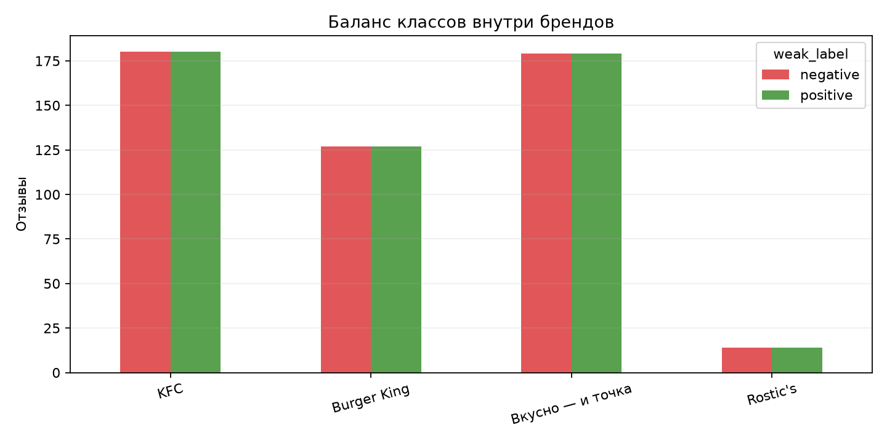

В итоговой тысяче 367 отзывов с рейтингом 1, 133 с рейтингом 2, 102 с рейтингом 4 и 398 с рейтингом 5.

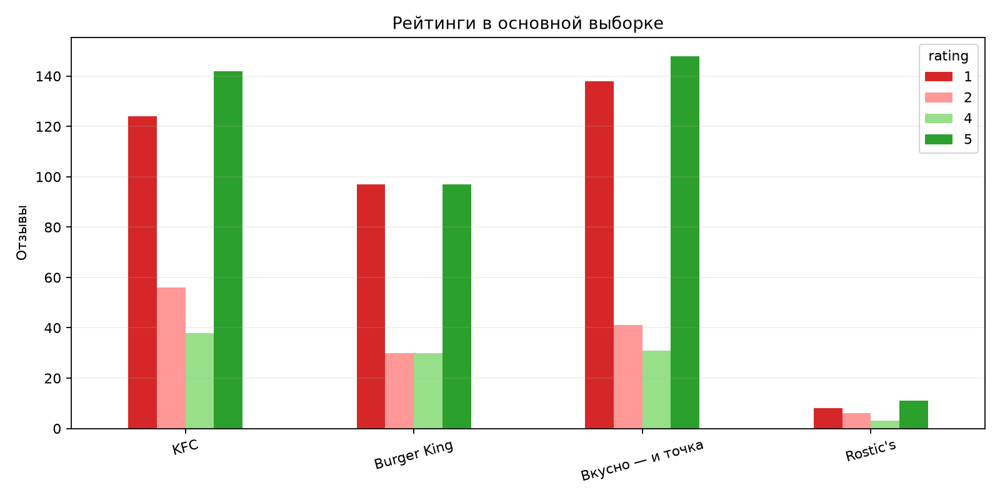

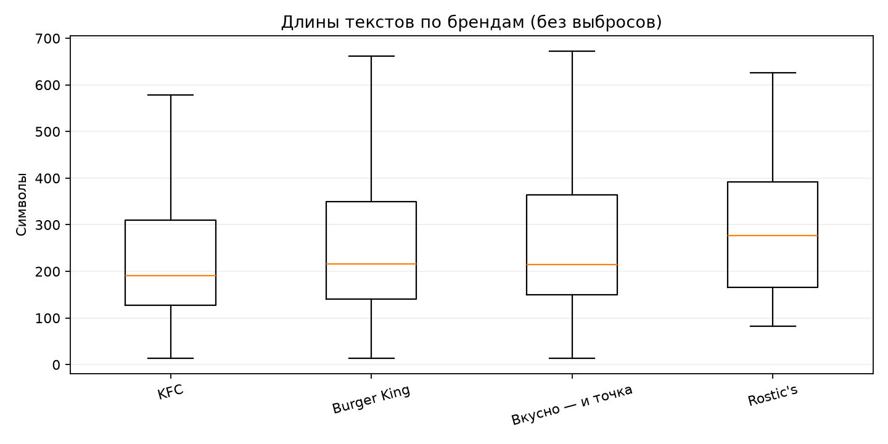

### Разбиения и ручное обогащение

Размеры `Original`: train — 700, validation — 150, test — 150. В каждой части классы сбалансированы; нормализованные тексты и `source_id` между частями не пересекаются.

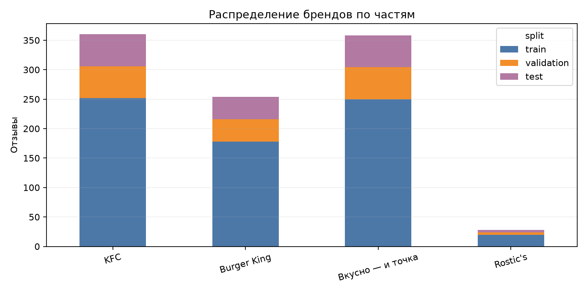

В режиме `Manual` к train добавлены 200 отзывов Otzyvru: KFC — 70, Burger King — 70, McDonald's — 60. Размеры становятся 900/150/150, а validation и test остаются неизменными.

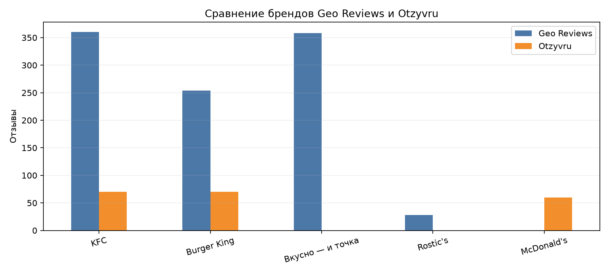

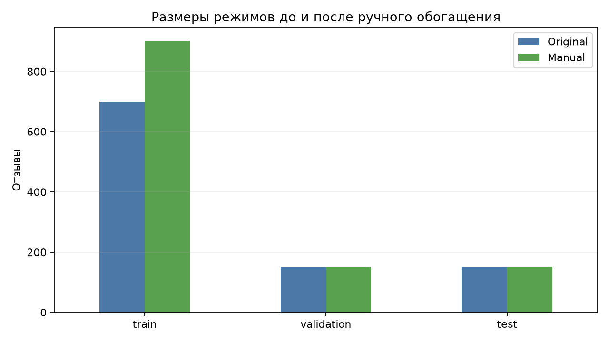

Разный состав брендов Geo Reviews и Otzyvru необходимо учитывать при интерпретации эффекта ручного обогащения. Контроль 50 строк `Original/train` показал 46 совпадений ручной и слабой меток и четыре расхождения.

## HaGRIDv2

Используемое подмножество содержит по 1 000 изображений каждой из 34 категорий. Это баланс процедуры отбора, а не естественное распределение полного HaGRIDv2.

| Показатель | Значение |
| --- | ---: |
| Изображения | 34 000 |
| Категории | 34 |
| Варианты разрешения | 287 |
| Наиболее частое разрешение | 512×683 (21 033) |
| Нечитаемые изображения | 0 |

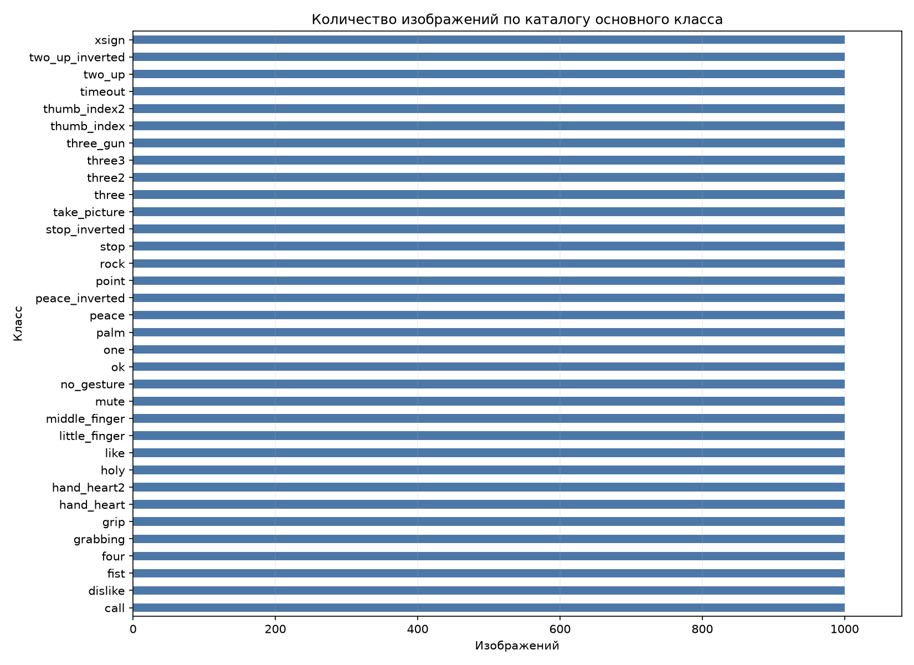

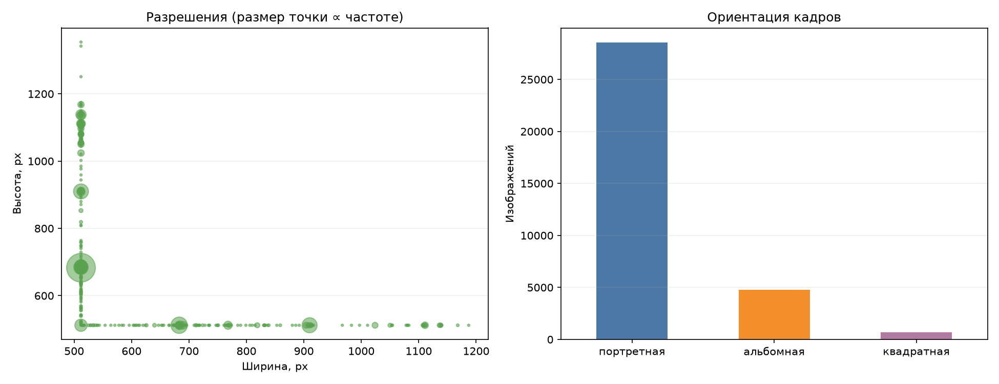

### Детекционная разметка

| Показатель | Значение |
| --- | ---: |
| Аннотированные изображения | 33 991 |
| Bounding boxes | 47 221 |
| Bbox жестов | 40 000 |
| Bbox `no_gesture` | 7 221 |
| Уникальные непустые `user_id` | 10 586 |
| Записи без `user_id` | 180 |

Среди аннотированных изображений 20 761 содержит один bbox и 13 230 — два. Среднее число bbox равно 1,3892.

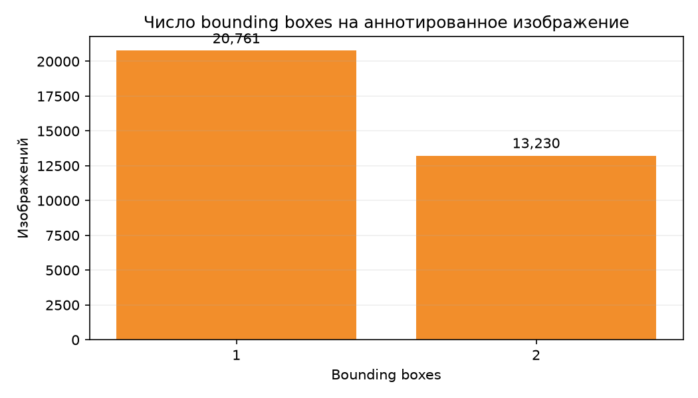

Медианная площадь bbox составляет 1,98% кадра: 2,15% для жестов и 1,08% для `no_gesture`. Небольшие объекты требуют достаточного входного разрешения.

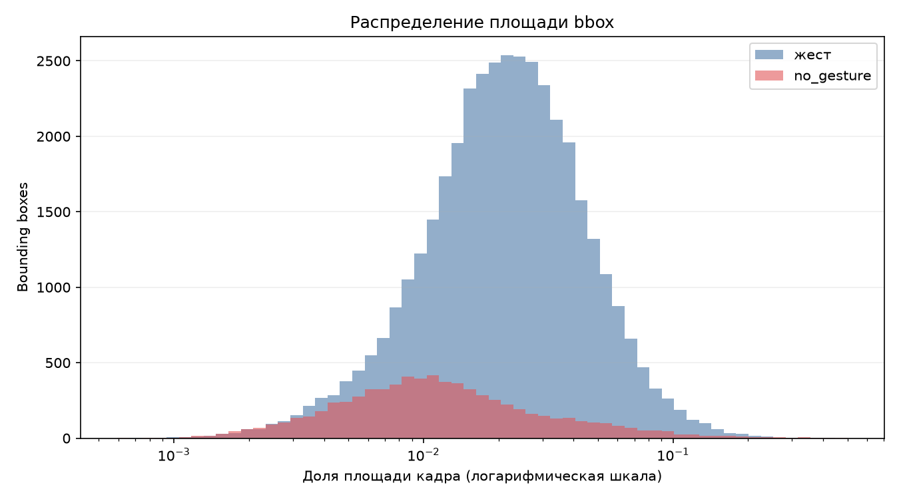

У одного известного `user_id` встречается от 1 до 44 изображений. Разбиение должно выполняться по участникам, а не случайно по кадрам.

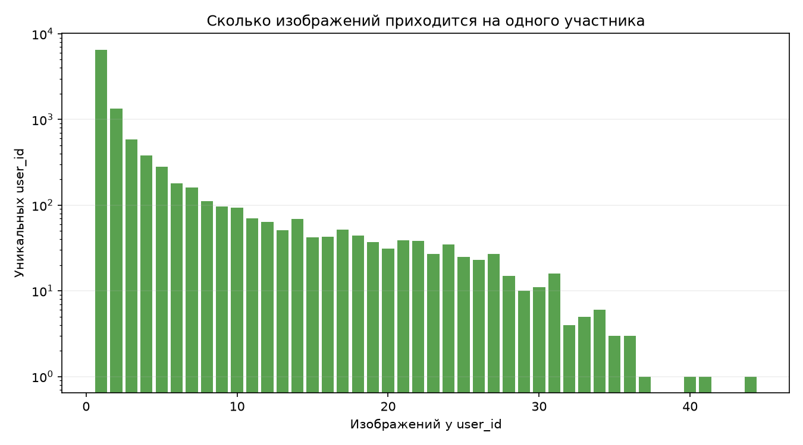

Известные ограничения: девять изображений без детекционной аннотации, 180 записей без `user_id`, десять bbox с небольшим выходом за границы и пять точных копий `*-checkpoint.jpg`.

### Дополнительные изображения

Для ручного обогащения отобрано 200 уникальных изображений [CNGR/CN_Gesture_Recognition](https://huggingface.co/datasets/CNGR/CN_Gesture_Recognition): по 50 классов `like`, `dislike`, `palm` и `fist`. Точных пересечений с 34 000 изображений HaGRID не обнаружено. Два экспорта Label Studio полны, классы совпали на всех 200 изображениях, 199 bbox совпали точно, а IoU единственной различающейся рамки равен 0,873.

## Выводы

Geo Reviews пригоден для текстовой задачи после предметного отбора, балансировки, удаления пересечений и учёта шума слабых меток. Подмножество HaGRID пригодно для классификации или детекции после группового разбиения по `user_id` и обработки известных исключений. В обоих датасетах ручное обогащение подготовлено и проверено; обучение моделей и искусственное обогащение ещё не выполнялись.
