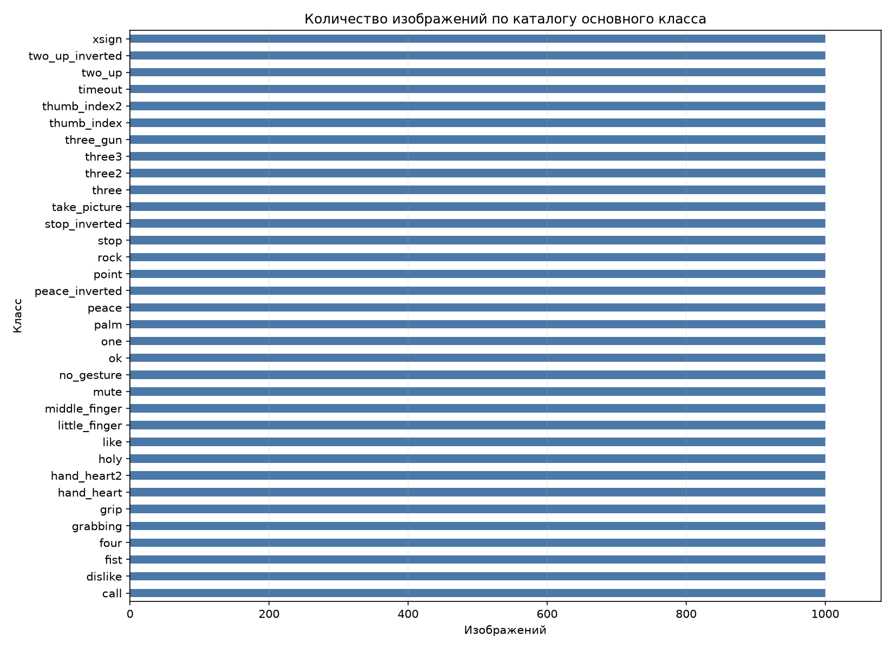
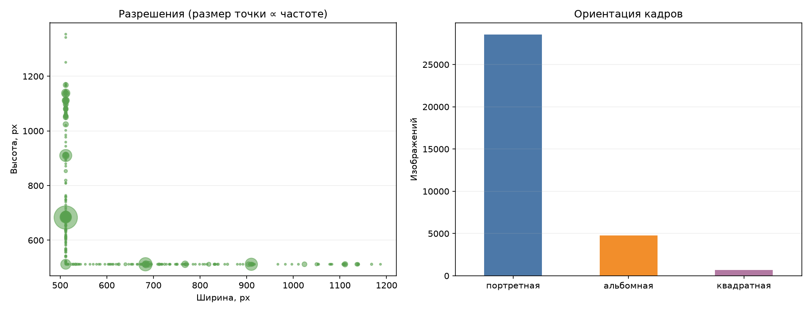
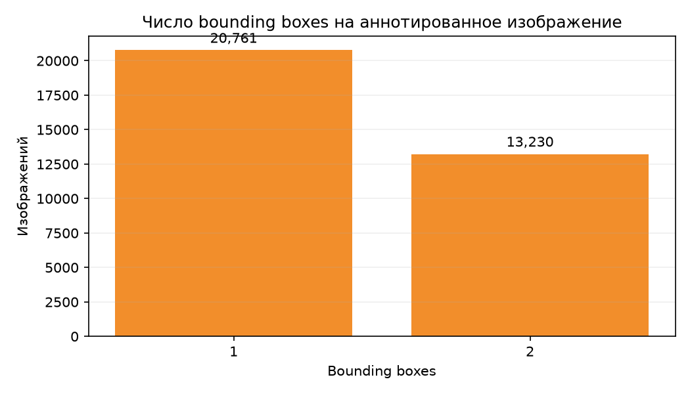
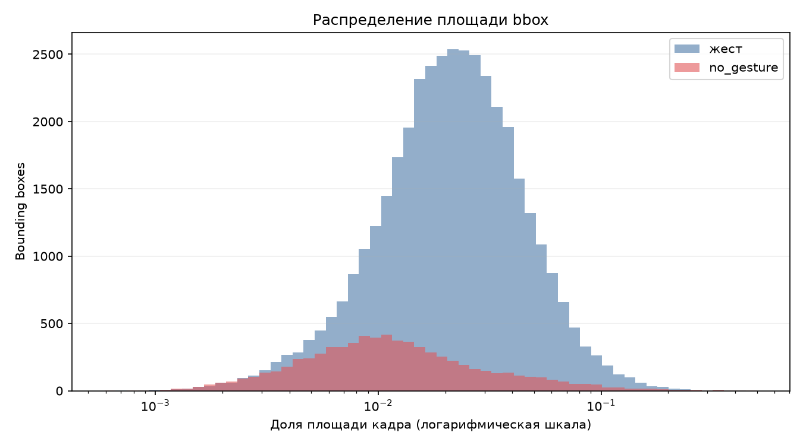
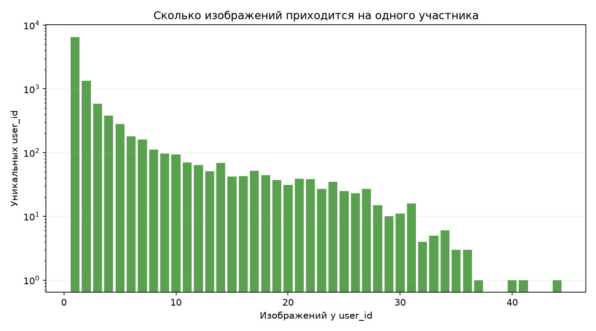

# Результаты разведочного анализа данных

## Цель анализа

Разведочный анализ данных (EDA) выполнен до формирования рабочих выборок и обучения моделей. Цель анализа — оценить структуру данных, распределения, качество разметки и факторы, способные повлиять на эксперимент.

## Geo Reviews Dataset 2023

### Структура и качество

| Показатель | Значение |
| --- | ---: |
| Строки | 500 000 |
| Поля | 5 |
| Пропуски `name_ru` | 970 |
| Пропуски в остальных полях | 0 |
| Пустые тексты | 0 |
| Лишние полные дубликаты | 1 |
| Строки с повторяющимся текстом | 190 |
| Лишние копии текста | 115 |

Повторяющиеся тексты необходимо группировать до формирования обучающей, валидационной и тестовой выборок.

### Рейтинги и предварительная тональность

| Рейтинг | Отзывы | Доля |
| --- | ---: | ---: |
| 0 | 200 | 0,0400% |
| 1 | 34 351 | 6,8702% |
| 2 | 12 088 | 2,4176% |
| 3 | 21 686 | 4,3372% |
| 4 | 41 160 | 8,2320% |
| 5 | 390 515 | 78,1030% |

При предварительном правиле `1–2 → negative`, `4–5 → positive` получаются 46 439 отрицательных и 431 675 положительных примеров. Соотношение классов составляет 9,30:1, поэтому рабочая выборка требует контролируемого отбора и балансировки.

### Длина и категории текстов

| Показатель | Символы | Слова |
| --- | ---: | ---: |
| Минимум | 2 | 1 |
| Медиана | 215 | 30 |
| Среднее | 303,23 | 43,74 |
| 95-й перцентиль | 809 | 120 |
| Максимум | 20 162 | 2 918 |

Отрицательные отзывы в среднем длиннее положительных. Длина текста может стать нежелательным косвенным признаком и должна учитываться при формировании выборок.

Наиболее частые категории полного датасета — `Кафе`, `Ресторан` и `Гостиница`. Предметная область курсовой ограничена заведениями быстрого питания, поэтому требуется отдельный критерий отбора.

Все графики этого раздела рассчитаны на полном Geo Reviews. Предметный отбор,
рабочие варианты и дополнительные агрегированные графики приведены в
[отдельном отчёте](fastfood_eda_summary.md).

## HaGRIDv2

### Состав подмножества

| Показатель | Значение |
| --- | ---: |
| Категории | 34 |
| Изображения | 34 000 |
| Изображения на категорию | 1 000 |
| Формат | RGB JPEG |
| Варианты разрешения | 287 |
| Наиболее частое разрешение | 512×683 (21 033 изображения) |
| Нечитаемые изображения | 0 |

Равное число изображений по категориям обеспечено процедурой отбора. Этот баланс не характеризует распределение полного HaGRIDv2.

Преобладает портретная ориентация. Разнообразие разрешений требует масштабирования с сохранением пропорций или дополнением полями.

### Аннотации ограничивающих прямоугольников

Для детекционной разметки используются ограничивающие прямоугольники (bounding box, bbox).

| Показатель | Значение |
| --- | ---: |
| Аннотированные изображения | 33 991 |
| Ограничивающие прямоугольники | 47 221 |
| Ограничивающие прямоугольники жестов | 40 000 |
| Ограничивающие прямоугольники `no_gesture` | 7 221 |
| Уникальные непустые `user_id` | 10 586 |
| Записи без `user_id` | 180 |

Среди аннотированных изображений 20 761 содержит один bbox, 13 230 — два. Среднее число bbox равно 1,3892.

Медианная площадь bbox составляет 1,98% кадра. Для жестов медиана равна 2,15%, для `no_gesture` — 1,08%. Небольшие объекты требуют достаточного входного разрешения модели.

Для известных участников медианное число изображений на `user_id` равно 1, 95-й перцентиль — 15, максимум — 44. Случайное разделение по изображениям создаёт риск попадания одного участника в разные выборки.

Выборочная визуальная проверка категорий `call`, `hand_heart` и `no_gesture` подтвердила интерпретацию bbox как `[x, y, width, height]`. Изображения людей в отчёт не включены.

## Обнаруженные ограничения

### Geo Reviews

- сильный дисбаланс предварительных классов;
- шум слабой разметки по рейтингу;
- повторяющиеся тексты;
- возможная зависимость от длины и категории организации;
- окончательный размер фастфуд-выборки и объём ручной проверки ещё не согласованы.

### HaGRIDv2

- 9 изображений не имеют детекционной аннотации;
- 180 записей не содержат `user_id`;
- 10 bbox незначительно выходят за границы изображения;
- 5 файлов `*-checkpoint.jpg` совпадают с другими изображениями;
- готовое разделение на обучающую, валидационную и тестовую выборки отсутствует;
- перцептивный поиск визуально сходных изображений не выполнялся.

## Выводы

Geo Reviews пригоден как источник текстов после предметного отбора, балансировки и ручной проверки слабых меток. Подмножество HaGRIDv2 пригодно для EDA и разработки прототипов классификации или детекции после утверждения правил обработки исключений и группового разделения по `user_id`.
