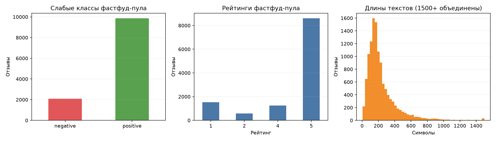
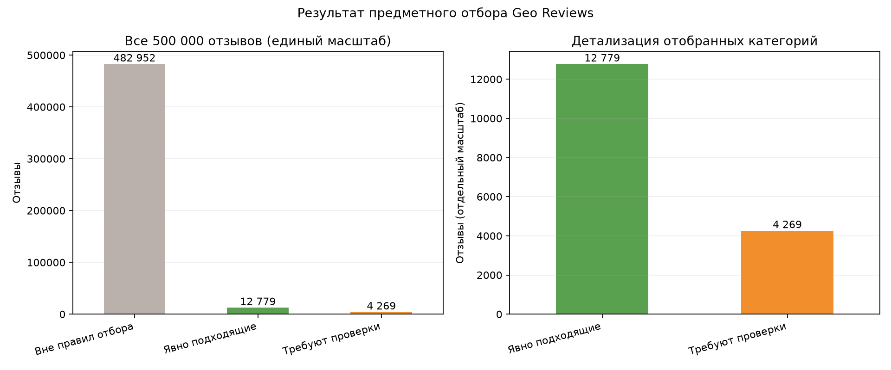
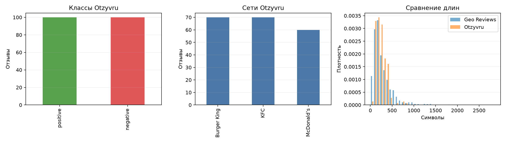

# Подготовка и EDA первого датасета

## Предметный отбор Geo Reviews

Полный набор из 500 000 строк обработан без изменения исходного Parquet. Точная
рубрика `Быстрое питание`, со-рубрики и известные названия сетей используются
совместно. Строка считается явно подходящей, если содержит точную рубрику без
неоднозначной со-рубрики либо одновременно содержит рубрику и узнаваемое
название сети. Сочетания с `Ресторан`, `Бар, паб`, `Столовая`, `Банкетный зал`
или `Гостиница` без сильного признака сети оставлены кандидатами для проверки.

| Результат отбора | Строк | Доля полного набора |
| --- | ---: | ---: |
| Явно подходящие | 12 779 | 2,5558% |
| Требуют дополнительной проверки | 4 269 | 0,8538% |
| Вне правил отбора | 482 952 | 96,5904% |

Среди явно подходящих строк 11 970 имеют рейтинги 1–2 или 4–5. После
нормализованной дедупликации осталось 11 968 уникальных текстов: 2 102 со слабой
отрицательной меткой и 9 866 со слабой положительной меткой. Конфликтующих
слабых меток внутри нормализованных групп не найдено; удалены только две лишние
копии из рабочих вариантов, исходные данные сохранены.

| Показатель длины | Символы |
| --- | ---: |
| Минимум | 6 |
| Медиана | 179 |
| Среднее | 237,43 |
| 95-й перцентиль | 611 |
| Максимум | 3 344 |

## Рабочие варианты

С фиксированным `seed = 20261118` сформированы сбалансированные варианты на 200,
500 и 1 000 отзывов. Максимальный сбалансированный вариант содержит 4 204
строки. Все построчные файлы находятся в Git-игнорируемом
`data/processed/geo_fastfood/`.

Предварительно рекомендуется согласовать вариант **1 000**. Его исходный train
содержит 700 объектов; после добавления 200 ручных отзывов train содержит 900
объектов. Таким образом, объём обучающей части увеличивается на
`200 / 700 ≈ 28,6%`. Validation и test остаются одинаковыми в режимах
`original` и `manual` — по 150 объектов. Вариант 500 остаётся полезным
контрольным сценарием, а рекомендация 1 000 не является утверждённым решением
преподавателя.

## Дополнительные 200 отзывов

Комплектный `verify_annotations.py` и независимый проектный аудит подтвердили:

| Показатель | Значение |
| --- | ---: |
| Уникальные ID / непустые тексты | 200 / 200 |
| Положительные / отрицательные | 100 / 100 |
| Совпадения двух участников | 199 |
| Расхождения | 1, только ID 15 |
| Percentage Agreement | 99,5% |
| Cohen's Kappa | 0,990 |
| Точные и нормализованные дубликаты | 0 |

Матрица независимых решений до согласования:

|  | Участник 2: 0 | Участник 2: 1 |
| --- | ---: | ---: |
| **Участник 1: 0** | 100 | 0 |
| **Участник 1: 1** | 1 | 99 |

ID 15 после совместного обсуждения получил итоговую положительную метку. Ни
одна исходная независимая метка при этом не изменялась.

### Сети, классы и рейтинги источника

| Сеть | Отрицательные | Положительные | Всего |
| --- | ---: | ---: | ---: |
| Burger King | 35 | 35 | 70 |
| KFC | 35 | 35 | 70 |
| McDonald's | 30 | 30 | 60 |

Исходные рейтинги присутствуют во всех 200 строках: рейтинг 1 — 89, 2 — 11,
4 — 18, 5 — 82. В этом наборе итоговые ручные метки полностью совпадают с
бинарным направлением рейтинга `1–2 → 0`, `4–5 → 1`. Это наблюдаемое свойство
набора и основание для дополнительного контроля, но само по себе не доказывает,
что участники использовали рейтинг вместо текста.

| Показатель длины | Символы |
| --- | ---: |
| Минимум | 56 |
| Медиана | 222,5 |
| Среднее | 242,01 |
| 95-й перцентиль | 417,2 |
| Максимум | 813 |

Автоматический флаг выше 99-го перцентиля получили ID 95 и 118. Они не удалены:
необычная длина сама по себе не является ошибкой.

### Происхождение

`05_provenance.csv` содержит 200 уникальных ID и 200 уникальных пар
`сеть + source_row`. Сохранены три URL страниц сетей, но не индивидуальные URL
отзывов. Все 200 строк относятся к сбору 10.11.2026; дата синхронизирована из
заполненного `annotation_metadata.md`. Открытая лицензия на повторное
использование текстов Otzyvru не подтверждена. Структура XLSX-отчёта исправна;
в нём пять листов: «Итоги», «Сравнение», «Согласование», «Правила», «Источники».

### Пересечения источников

Сравнение всех 200 текстов с 500 000 строк Geo Reviews не обнаружило точных,
нормализованных или близких совпадений при пороге 0,88. Полный попарный перебор
не использовался: кандидаты для близкого сравнения предварительно блокировались
по биграммам слов. Автоматического удаления объектов не выполнялось.

## Сравнимость источников

Geo Reviews и Otzyvru различаются происхождением и способом получения метки.
Для Geo Reviews рейтинг 1–2/4–5 используется только как слабая метка. Для
Otzyvru итоговая метка получена независимой ручной разметкой и согласованием.

Оба сравниваемых рабочих набора сбалансированы по классам. В варианте Geo
Reviews на 1 000 строк представлены восемь сетевых групп, включая 683 объекта
`Other / independent`; Otzyvru ограничен тремя сетями. У Geo Reviews средняя
длина выше (280,73 против 242,01), но медиана ниже (206 против 222,5), а верхний
хвост существенно длиннее (95-й перцентиль 670,9 против 417,2). Сравнение нужно
интерпретировать с учётом разных источников и разных способов получения метки.
Будущую разницу метрик моделей нельзя объяснять исключительно качеством ручной
разметки: одновременно меняются объём train на 28,6% и источник добавленных
текстов.

## Результаты ручного контроля Geo Reviews

Для оценки качества слабых меток подготовлен Git-игнорируемый файл
`.local/geo_quality_checks/weak_label_manual_check_50.csv`. Он содержит 50
воспроизводимо отобранных строк: 34 из train и по 8 из validation/test, поровну
из классов 0 и 1. Сохранены ID, текст, рейтинг, слабая метка и часть разбиения.
Поле `manual_quality_check` намеренно оставлено пустым.

Для проверки предметного фильтра подготовлен
`.local/geo_quality_checks/other_independent_review_30.csv`: 30 объектов
`Other / independent`, оба класса и все три части. Поле
`manual_fastfood_check` оставлено пустым. Эти проверки не изменяют метки,
разбиение или правила предметного отбора.

После ручного заполнения исходные и заполненные файлы были сопоставлены по ID и
всем неизменяемым полям.

### Контроль слабой тональности

| Результат | Строк |
| --- | ---: |
| Совпадение ручной и слабой меток | 49 |
| Определённое несовпадение | 0 |
| Неоднозначно | 1 |
| **Всего** | **50** |

Неоднозначный объект — `geo:362321`. Его исходная слабая метка не изменена и
ручная метка автоматически не присвоена. Совпадение `49/49` среди определённых
решений не является доказательством стопроцентной корректности слабых меток
полного Geo Reviews: проверка мала и сформирована стратифицированно.

### Контроль `Other / independent`

| Результат | Строк |
| --- | ---: |
| Подтверждено как фастфуд | 24 |
| Не относится к фастфуду | 2 |
| Не определено | 4 |
| **Всего** | **30** |

Среди 26 определённых решений доля подтверждённых равна
`24 / 26 = 92,3%`. Неопределённые ID: `geo:438599`, `geo:19620`,
`geo:114034`, `geo:182237`. Два отклонённых объекта не удалены, четыре пустых
решения не преобразованы в 0 или 1. Это небольшая контрольная выборка, а не
доказанная точность предметного фильтра на всём Geo Reviews.

Агрегированная локальная сводка без текстов находится в
`.local/geo_quality_checks/results_summary.json`.

### Рекомендация

До эксперимента следует согласовать с преподавателем, нужно ли вручную
проверить более крупную выборку `Other / independent` и исключить подтверждённо
нерелевантные объекты. Текущую рабочую выборку автоматически корректировать не
следует: объём контроля мал, четыре предметных решения и одна тональность пока
не определены, а любое удаление изменит зафиксированное разбиение.
